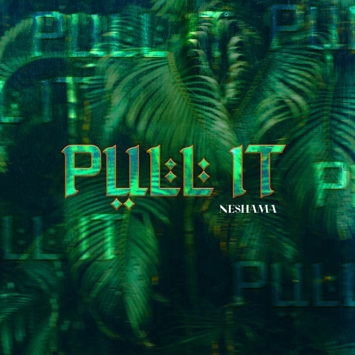

# Joe Basrawi

**Musician and software builder.**

I make house music as **neshama** and build software for music, the web, and whatever problem is annoying me that week.

Miami Beach, Florida

**Listen:** [Spotify](https://open.spotify.com/artist/02TGohZoEi4afDEjJwUfFp) · [Apple Music](https://music.apple.com/us/artist/neshama/890628014) 
**Sets & mixes:** [SoundCloud](https://soundcloud.com/neshamaofficial) · [Live sets](https://linktr.ee/neshamamusic) 
**Follow:** [Instagram @neshama.us](https://www.instagram.com/neshama.us)

### Music

**neshama**.

### Discography

  
  
  
  
  
  
  

2026: Turn Me On · Just like u · What it feel like 
2025: GET NAUGHTY 
2024: Limerence 
2023: Love Me Loko · Pull It

### Software

**[CROSSLIST](https://github.com/joebasrawi/CROSSLIST)** moves a public Spotify playlist into Apple Music from a native iPhone app. Music authorization and playlist creation stay on-device.

SwiftUI · MusicKit · FastAPI

### Open source

I contribute fixes and product work to projects I use. Recent merged work includes browser improvements for [Oracle](https://github.com/steipete/oracle/pull/404) and native app work for [Isaac](https://github.com/aribradshaw/Isaac/pulls?q=is%3Apr+author%3Ajoebasrawi+is%3Amerged).

[View my public pull requests](https://github.com/pulls?q=is%3Apr+author%3Ajoebasrawi)
