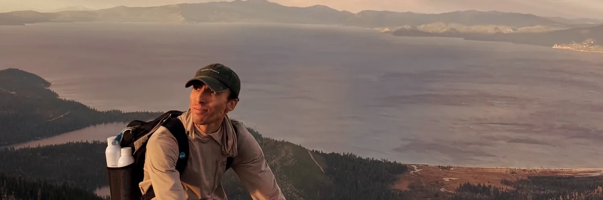
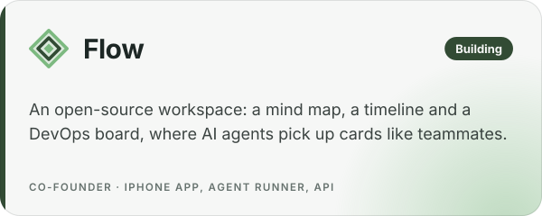
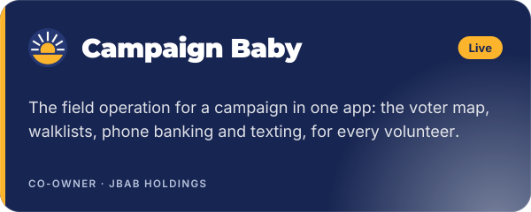
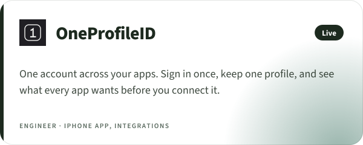
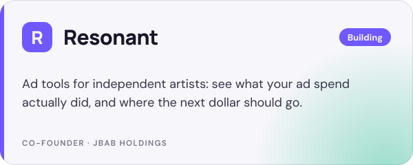
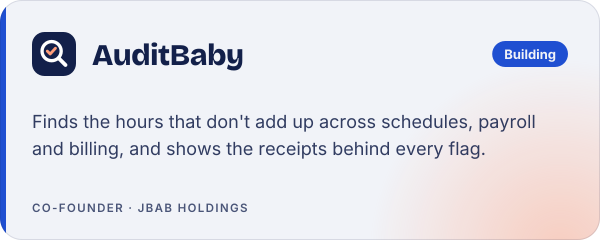
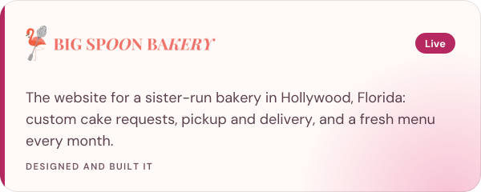
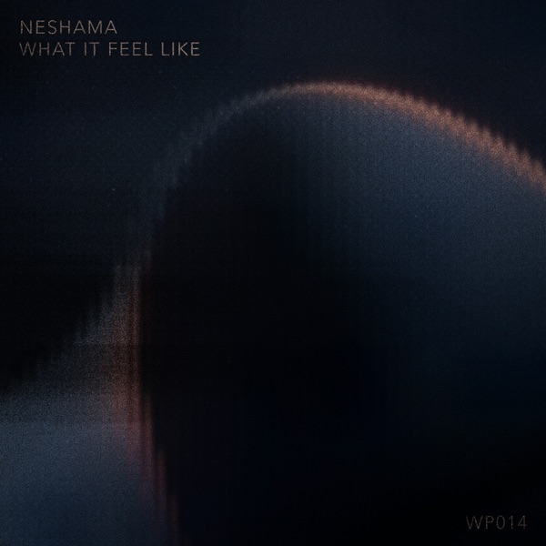
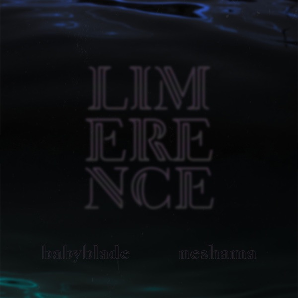

Based in Miami Beach. I co-founded JBAB Holdings with [Ari Bradshaw](https://github.com/aribradshaw), and most of my days go into turning ideas into products people actually use. I also make house music as **neshama**.

**Site & dev log:** [joebasrawi.dev](https://joebasrawi.dev) · **Follow:** [Instagram](https://instagram.com/joebasrawi) · [X](https://x.com/joebasrawi)

### Right now

<!-- NOW:START -->
- **[Big Spoon Bakery](https://joebasrawi.dev/projects/big-spoon)** · Live · 3 days ago
- 🔒 Secret project #1156 · In the works · yesterday
- **[Resonant](https://joebasrawi.dev/projects/resonant)** · Building · 4 days ago
- 🔒 Secret project #6670 · In the works · 3 days ago
- **[OneProfileID](https://joebasrawi.dev/projects/opid)** · Live · 4 days ago
- **[Flow for iPhone](https://joebasrawi.dev/projects/flow-ios)** · Beta · 5 days ago
- **[Flow](https://joebasrawi.dev/projects/flow)** · Building · 4 days ago
- 🔒 Secret project #3810 · In the works · 4 days ago
<!-- NOW:END -->

Updated daily from [my Now page](https://joebasrawi.dev/now). Secret means it isn't mine to announce yet.

### What I'm building

  
  

  
  

  
  

Every project has its own page on [joebasrawi.dev/projects](https://joebasrawi.dev/projects).

### Open source

[Flow](https://github.com/aribradshaw/flow) is open source, and I built its [iPhone and iPad app](https://github.com/aribradshaw/flow/tree/main/apps/ios). I also send fixes to tools I use: a standalone manuals viewer for [openDAW](https://github.com/andremichelle/openDAW/pull/370), configurable filesystem roots for [Chrome DevTools MCP](https://github.com/ChromeDevTools/chrome-devtools-mcp/pull/2605), capability audit facts for [Apache Maka](https://github.com/apache/maka/pull/3815), a pandas index fix for [Great Expectations](https://github.com/fivetran/great_expectations/pull/12097), and Deep Research thinking time for [oracle](https://github.com/steipete/oracle/pull/404).

### Latest from the dev log

<!-- DEVLOG:START -->
- [Closing the small holes in Flow's server](https://joebasrawi.dev/log/2026-11-23-flow-hardening/) Nov 23, 2026
- [The board flickered, so I deleted a pager](https://joebasrawi.dev/log/2026-11-23-flow-ios-board-flicker/) Nov 23, 2026
- [Nine TestFlight builds in one day](https://joebasrawi.dev/log/2026-11-23-opid-nine-builds/) Nov 23, 2026
- [Resonant, back from a folder of unsaved work](https://joebasrawi.dev/log/2026-11-23-resonant-restart/) Nov 23, 2026
- [Flow on my phone in two days](https://joebasrawi.dev/log/2026-11-22-flow-iphone-two-days/) Nov 22, 2026
<!-- DEVLOG:END -->

[More at joebasrawi.dev/log](https://joebasrawi.dev/log)

### Music

I've been DJing since I was 14 and producing since I was 16. A new look and new music are on the way.

**Listen:** [Spotify](https://open.spotify.com/artist/02TGohZoEi4afDEjJwUfFp) · [Apple Music](https://music.apple.com/us/artist/neshama/890628014) · [SoundCloud](https://soundcloud.com/neshamaofficial) · [Instagram @neshama.us](https://www.instagram.com/neshama.us)

  
  
  
  
  
  
  

2026: Turn Me On · Just like u · What it feel like 
2025: GET NAUGHTY 
2024: Limerence 
2023: Love Me Loko · Pull It

### Off the clock

Camping, boating, fishing, diving and hiking.
