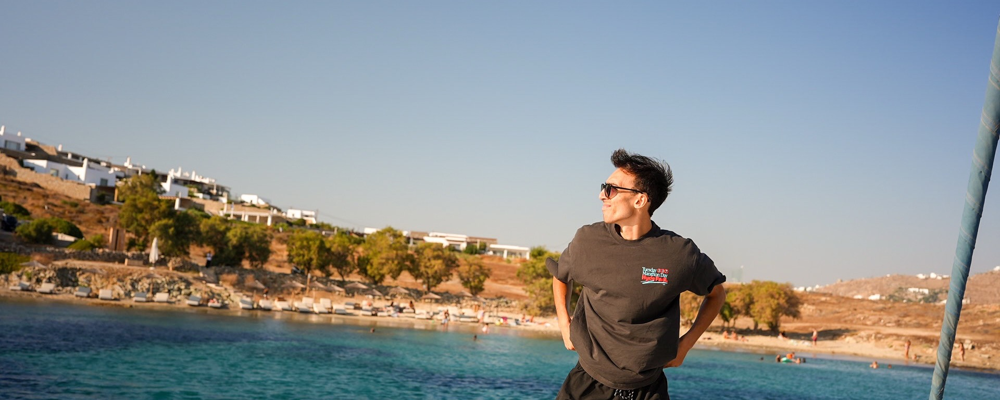
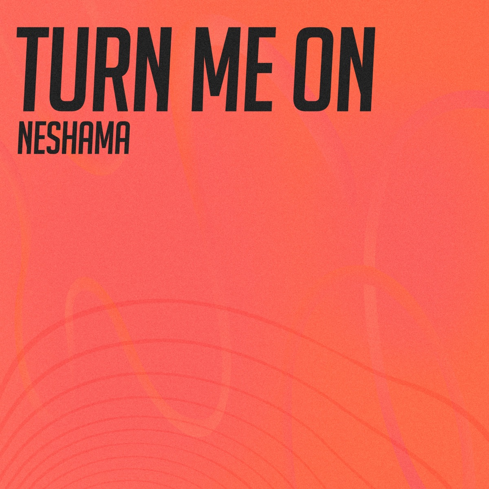
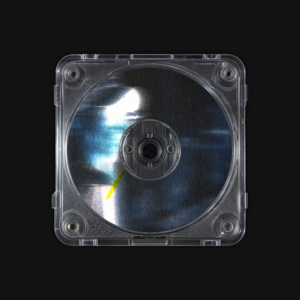
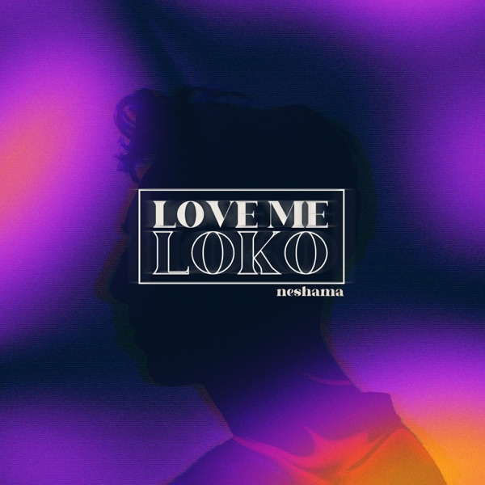

# Joe Basrawi

**Co-founder, builder and house music producer, based in Miami Beach.**

I co-founded JBAB Holdings with [Ari Bradshaw](https://github.com/aribradshaw), and most of my days go into turning ideas into products people actually use. I also make house music as **neshama**.

**Site & dev log:** [joebasrawi.dev](https://joebasrawi.dev) · **Follow:** [Instagram](https://instagram.com/joebasrawi) · [X](https://x.com/joebasrawi)

### What I'm building

**[Flow](https://flow.flygonlc.com)** · co-founder 
An open-source workspace: a mind map, a timeline and a DevOps board, where AI agents pick up cards like teammates. I built the [iPhone and iPad app](https://github.com/aribradshaw/flow/tree/main/apps/ios), the agent runner and API work. Built with Flygon LC. 
Node.js · Postgres · MCP · SwiftUI · [source](https://github.com/aribradshaw/flow)

**[Campaign Baby](https://campaign.baby)** · co-owner 
A campaign's whole field operation in one app: the voter map, walklists, phone banking and texting. [Try the demo](https://campaign-baby-demo-production.up.railway.app). 
React · Node.js · Postgres · Capacitor

**[OneProfileID](https://oneprofileid.com)** · iPhone app & integrations 
One account across a whole family of apps, with passkeys, pages, events, tickets and messages. 
Node.js · Better Auth · OIDC · Passkeys · SwiftUI

**[Resonant](https://joebasrawi.dev/projects/resonant)** · co-founder 
Ad tools for independent artists: see what your ad spend actually did and where the next dollar should go. I'm the first pilot, running it on my own releases. 
Next.js · TypeScript · Postgres

**[AuditBaby](https://joebasrawi.dev/projects/auditbaby)** · co-founder 
Finds the hours that don't add up across schedules, payroll and billing, with the receipts behind every flag. 
TypeScript · Node.js

**[Crosslist](https://joebasrawi.dev/projects/crosslist)** 
Share playlists across music apps. Send one link and your friend saves it in the app they already use. 
SwiftUI · MusicKit · FastAPI

**[Big Spoon Bakery](https://bigspoonbakery.com)** 
I designed and built the website: custom cake requests, catering, a new menu every month, and an editor the bakery runs from a phone. 
React · Vite · Supabase

### Open source

I send fixes to tools I use: a standalone manuals viewer for [openDAW](https://github.com/andremichelle/openDAW/pull/370), configurable filesystem roots for [Chrome DevTools MCP](https://github.com/ChromeDevTools/chrome-devtools-mcp/pull/2605), capability audit facts for [Apache Maka](https://github.com/apache/maka/pull/3815), a pandas index fix for [Great Expectations](https://github.com/fivetran/great_expectations/pull/12097), and Deep Research thinking time for [oracle](https://github.com/steipete/oracle/pull/404).

### Music

I've been DJing since I was 14 and producing since I was 16. A new look and new music are on the way.

**Listen:** [Spotify](https://open.spotify.com/artist/02TGohZoEi4afDEjJwUfFp) · [Apple Music](https://music.apple.com/us/artist/neshama/890628014) · [SoundCloud](https://soundcloud.com/neshamaofficial) · [Instagram @neshama.us](https://www.instagram.com/neshama.us)

  
  
  
  
  
  
  

2026: Turn Me On · Just like u · What it feel like 
2025: GET NAUGHTY 
2024: Limerence 
2023: Love Me Loko · Pull It

### Off the clock

Camping, boating, fishing, diving and hiking.
