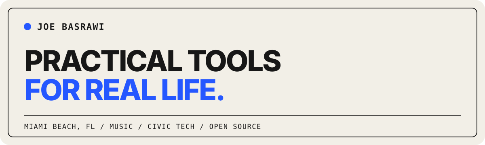

<picture>
  <source media="(prefers-color-scheme: dark)" srcset="./assets/profile-header-dark.svg">
  <source media="(prefers-color-scheme: light)" srcset="./assets/profile-header-light.svg">
  
</picture>

I build practical software for music and the web.

Based in Miami Beach. Currently contributing to open source and shipping small products that solve real problems.

### Featured project

**[CROSSLIST](https://github.com/joebasrawi/CROSSLIST)**  
Move a public Spotify playlist into Apple Music from a native iPhone app. Music authorization and playlist creation stay on-device.  
SwiftUI · MusicKit · FastAPI

### Open source

I contribute fixes and product work to projects I use. Recent merged work includes browser improvements for [Oracle](https://github.com/steipete/oracle/pull/404) and native app work for [Isaac](https://github.com/aribradshaw/Isaac/pulls?q=is%3Apr+author%3Ajoebasrawi+is%3Amerged).

[View my public pull requests](https://github.com/pulls?q=is%3Apr+author%3Ajoebasrawi)
